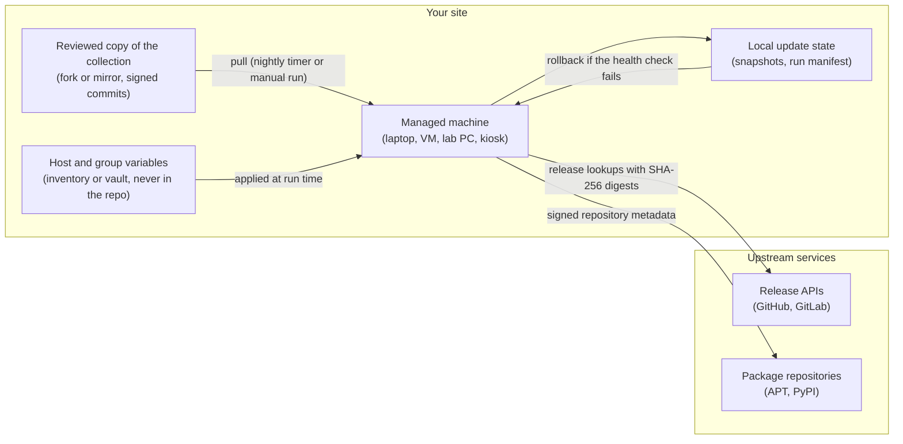

# Infrastructure patterns

This note explains the reusable maintenance, identity, network, registry and
deployment patterns behind the collection, without describing any
organization's topology. It is written for an unrelated lab deciding how to run
its own copy. The trust boundaries it draws are the ones in the
[threat model](threat-model.md).

## The pieces

Everything inside the "Your site" box is yours to place wherever suits the lab.
The collection needs no Curiosity account and no Curiosity service.

## Maintenance pattern

- Run the role from a controller or from the machine itself (`ansible-pull`).
  The timer runs nightly with a random delay that depends on the
  [update ring](update-rings.md), so canary machines go first.
- Keep your own reviewed copy and have each machine pull from it. A copy you
  control means a bad upstream change reaches a machine only after you accept
  it. Setting `catalog_integrity_mode: enforce` with your key's fingerprint makes
  the pull refuse unsigned commits. A ready host-local file is
  [`examples/lab-pull-maintenance.yml`](../examples/lab-pull-maintenance.yml).
- Each update takes a snapshot of managed files first, runs a health check
  afterwards, and rolls back on failure. The snapshot is a rollback aid, not a backup.

What this does not protect against: a compromised signer of your copy, a
malicious upstream release that carries a valid digest, and failures the health
check does not look for.

## Identity pattern

The public collection ships no identity provider, no private certificate
authority and no overlay network, and these default to off
([decision 0002](decisions/0002-optional-integrations-default-off.md)).
A lab that has its own identity provider, certificate authority or overlay network
turns the matching integration on in its own variables (see
[`docs/configuration.md`](configuration.md), "Optional private services" and
"Custom CA certificates") and supplies its own values from a vault. For a custom
CA, the operator names each certificate file; the role does not pin its
fingerprint, so review the file before listing it.

## Network pattern

- A machine needs outbound HTTPS to the upstream services above, or to a
  proxy and mirror that stand in for them: see the
  [restricted networks guide](quickstarts/restricted-networks.md).
- The role can enable a default-deny firewall on a machine with SSH limited to
  trusted interfaces, and strict DNS-over-TLS per link on untrusted networks
  (`tests/test_firewall_posture.py`).
- Treat notebook and development servers as loopback-only and reach them by
  SSH tunnel.

## Registry and release pattern

- Releases are built in CI as an artifact, an SBOM and provenance metadata; the
  [release checklist](release-checklist.md) compares checksums and states
  that signing and registry publication are manual steps for a maintainer.
- A lab that mirrors the collection in its own repository pins a tag or a signed
  commit, not a branch.

## Deployment pattern for a lab

1. Fork or mirror the repository; protect the default branch; require review.
2. Create a small inventory repository with one file per group, built from the
   [examples](../examples/README.md).
3. Put one or two machines on the `canary` ring and the rest on `general`.
4. Pull nightly; read `last-run.json` after the first week.
5. Rehearse a rollback on a disposable machine before a term starts.

## Internal-only components

Anything specific to Curiosity Research Corporation's own operations (internal
hostnames, trust anchors, host inventories, the agent-workstation profile and
private workstation policy) lives in a separate private downstream repository
and is not part of this collection
([decision 0001](decisions/0001-public-and-internal-repositories.md)). The
build fails if a known private marker appears in `roles/`, `playbooks/` or
`renovate.json` (`tests/test_public_contract.py`).

Two caveats are on record rather than hidden. The vendored StreamStack tree
under `roles/developer_workstation/files/streamstack` still names its own
upstream CI and registry hosts, and the test allows exactly two host markers there until
StreamStack becomes configuration-only. And `ansible_pull_repo` defaults to the
public GitHub repository, which a lab should override as shown above.

## Real deployments

This note describes patterns only. It names no real external deployment. A
deployment may be described here only with the operator's written permission and
only in aggregate detail, following the
[telemetry and evidence policy](telemetry-and-evidence.md).
